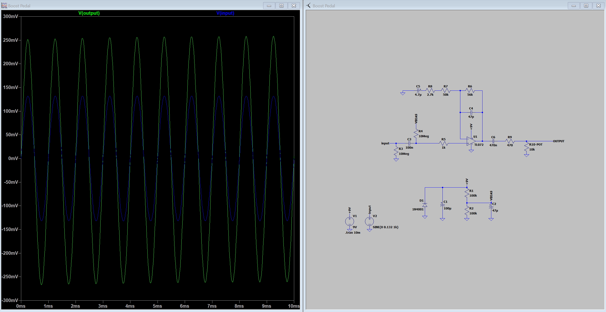
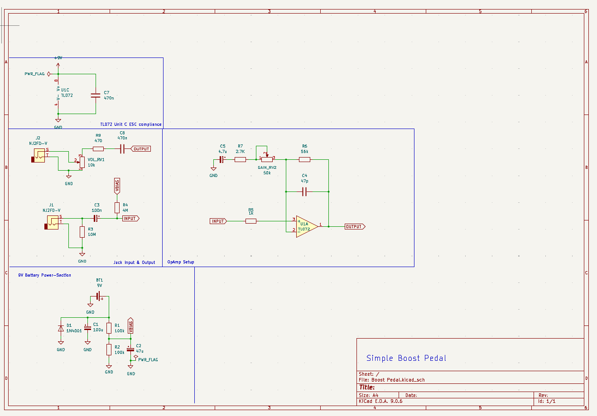
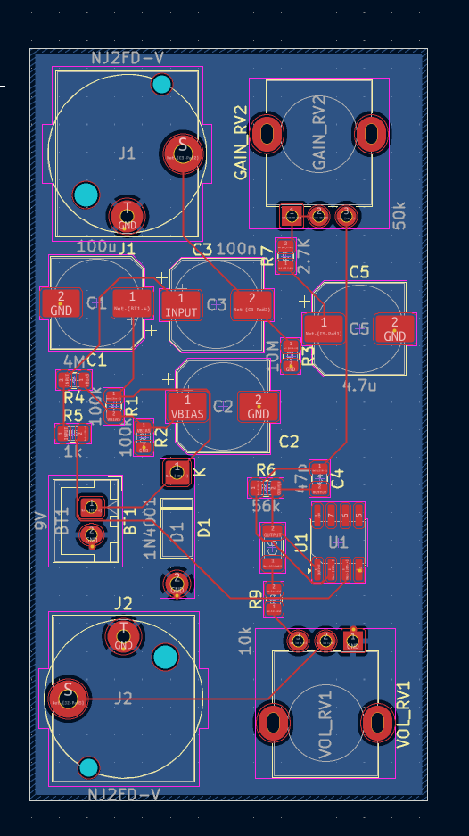
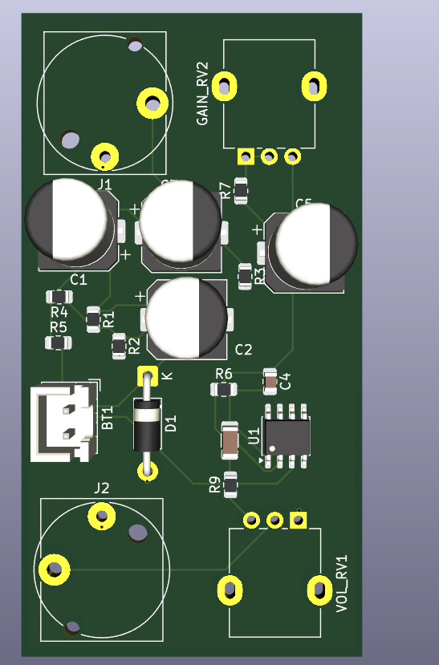

# Analog-Guitar-Pedals
Transcriptions of Notes/Designs for since starting to design guitar pedals. I just add my random finished pedals to this repo.

## Boost Pedal 
#### Schematics: 
Shows both the KiCad and LT Spice schematic design. The LT Spice has the probe open for the imput and output waveform.

***

#### KiCad PCB Mock up: 
Shows the mockup of the PCB and the routing.

***

