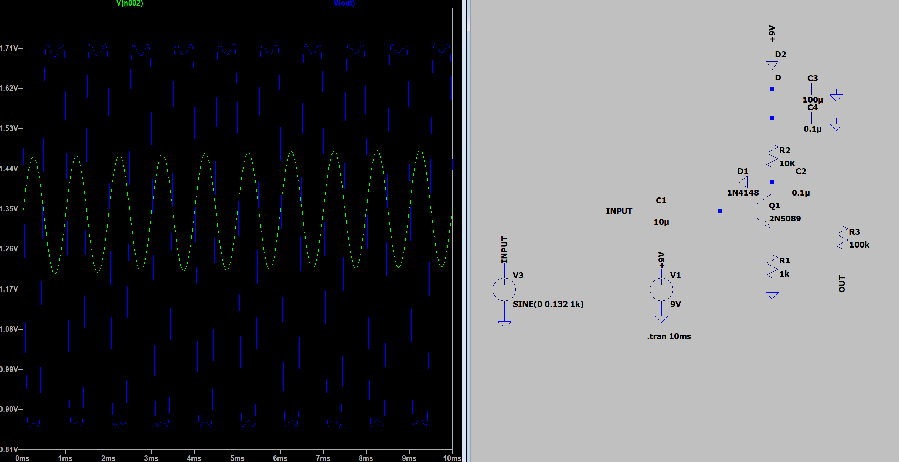
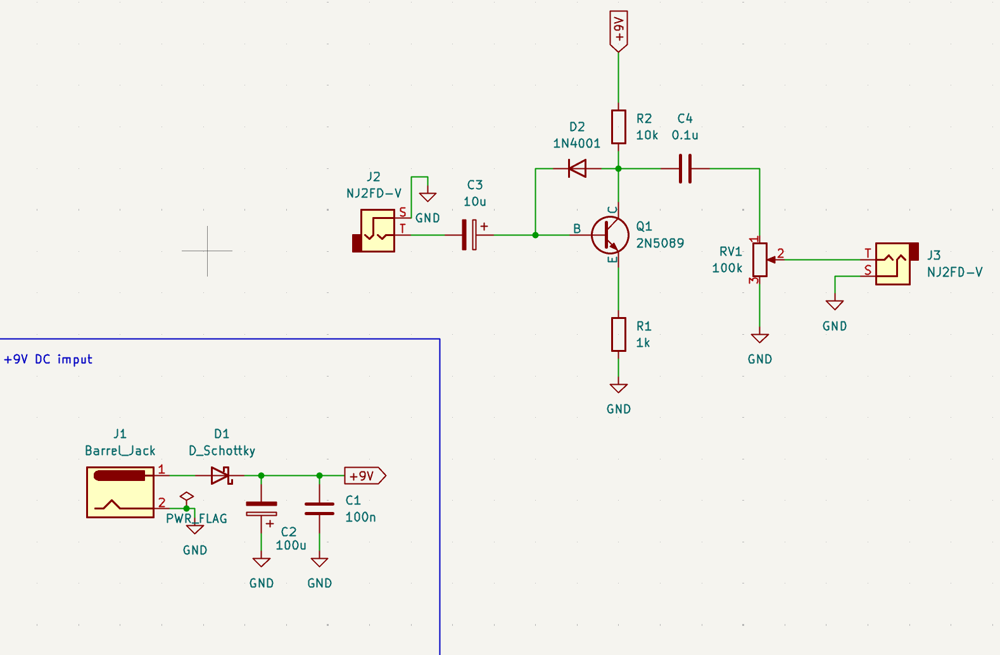
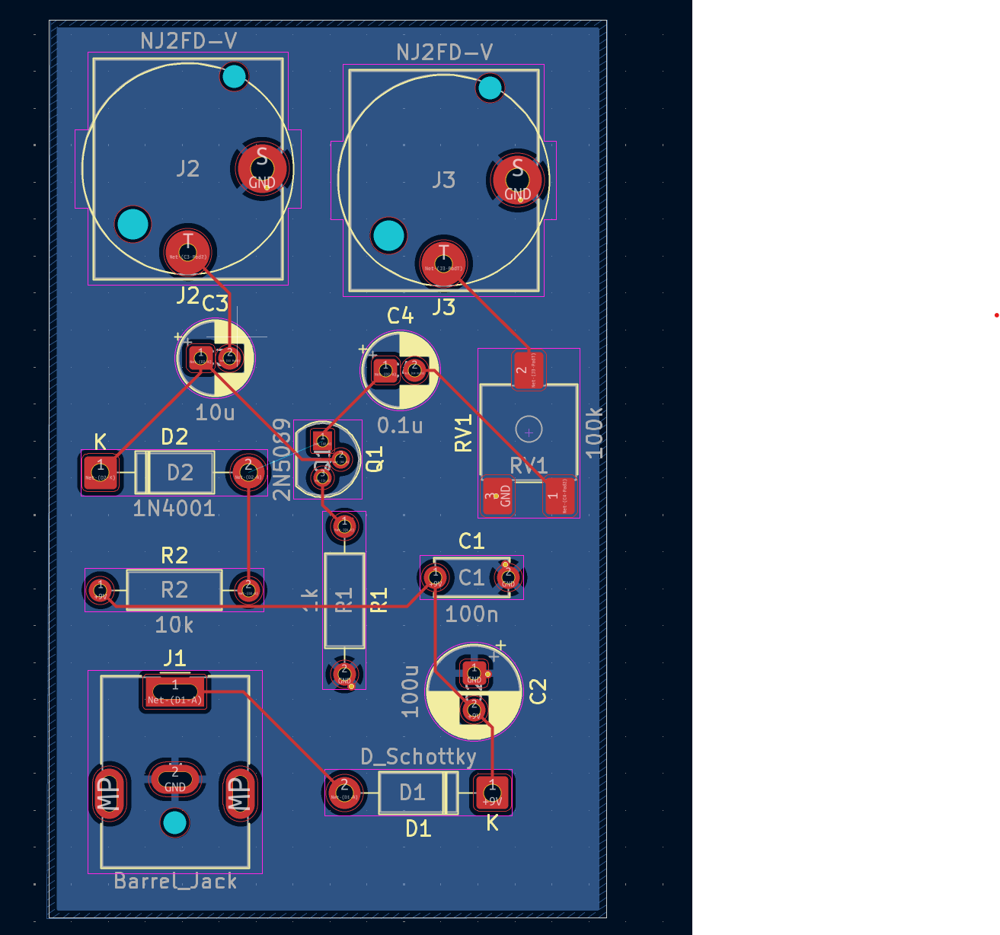
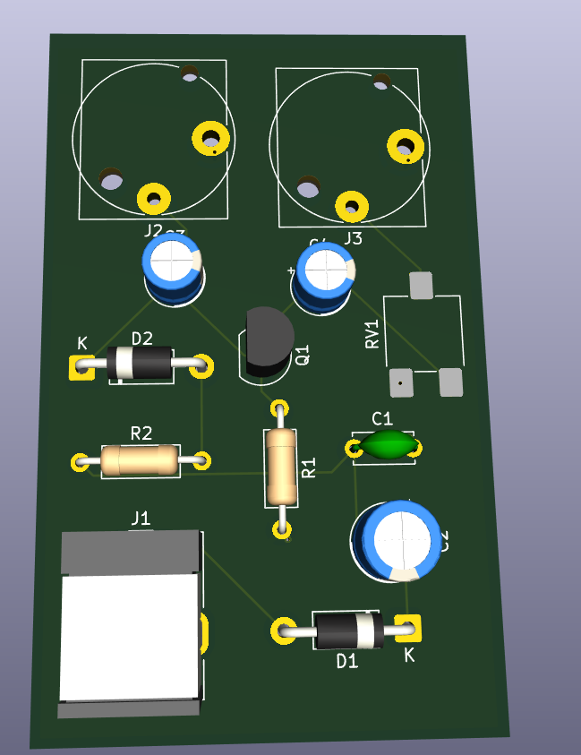

# Analog-Guitar-Pedals
Transcriptions of Notes/Designs for since starting to design guitar pedals. I just add my random finished pedals to this repo.

## Boost Pedal 
#### Schematics: 
Shows both the KiCad and LT Spice schematic design. The LT Spice has the probe for the imput and output waveform showing the boosted output.

***

#### KiCad PCB Mock up: 
Shows the mockup of the PCB and the routing. Uses 9V battery.

***

## Bazz Fuzz Pedal: Simple Pedal made off of the bazz fuzz typology.
#### Schematics: 
Shows both the KiCad and LT Spice schematic design. The LT Spice probs imput and output waveform showing the DC clipping at the output.

***

#### KiCad PCB Mock up: 
Shows the mockup of the PCB and the routing. Uses a 9V Barrel Jack.

***

